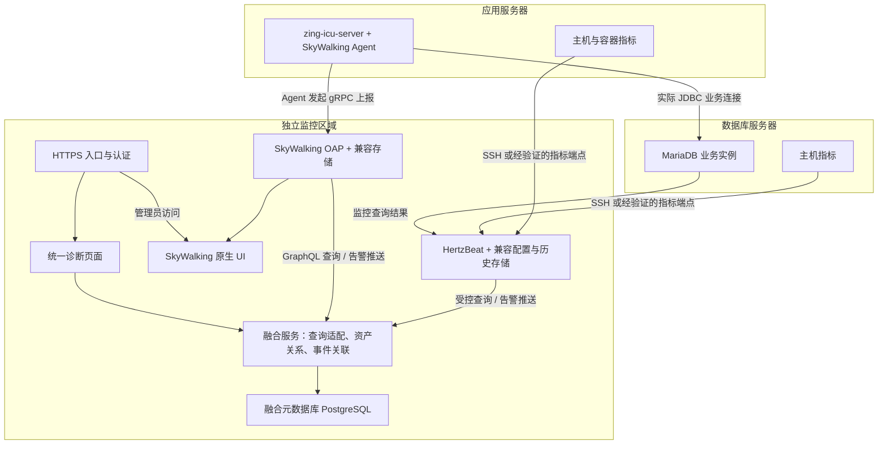

# 第三方性能监控与诊断平台工程设计方案

版本：V1.0（工程评审稿）  
设计日期：2026-11-05（Asia/Shanghai）  
适用场景：无业务源码、Docker 部署、应用与数据库位于不同服务器。  
方案组成：Apache HertzBeat + Apache SkyWalking + 自研融合服务与统一诊断页面。

## 1. 评审结论

本方案具备实施条件，建议先做一个站点、一个环境、一个 Java 服务的技术验证，再扩展到完整系统。

HertzBeat 负责基础设施、数据库状态及基础探测；SkyWalking 负责受支持的 Java 接口和调用链；自研部分负责资产关系、跨平台查询、统一页面、告警归一化和诊断报告。

采用适配器访问上游接口，保留两套平台核心代码。融合服务不直接读取两套平台的内部数据库，不复制全量调用链，不通过页面抓取建立长期接口。第一版不承诺自动确定根因，展示“疑似因素及证据”。

以下条件是进入业务环境试点的前置门槛：

1. 固定 HertzBeat、SkyWalking OAP、UI、Java Agent 及各自存储的具体版本，形成兼容清单。
2. 验证选定 Java Agent 支持 Java 8u202、实际 Web/JDBC 组件，确认业务容器可加载探针。
3. 验证 HertzBeat 对 MariaDB 10.5.6 的必需采集项及历史查询接口。
4. 明确应用实际连接的数据库、服务器归属和可用的网络通道。
5. 探针先在隔离测试环境验证，再安排业务服务维护窗口；基础监控可以先行接入。

本设计未进行现场部署或在线版本兼容验证。此前 GitHub 在线核对因自动审批服务返回 503 未完成，文中不将最新版本、现成插件或具体接口兼容性作为已验证事实。

## 2. 已知条件与待核实信息

### 2.1 已知条件

| 项目 | 已有信息 | 设计影响 |
|---|---|---|
| 业务架构 | 用户描述为 Spring Boot 2.7、Java 8、Docker | 允许通过启动参数加载 Agent，无须修改业务源码 |
| JVM | Oracle Java 1.8.0_202 | 必须锁定支持该版本的 Agent，避免直接使用未验证的最新版 |
| 后端入口 | `sleep 5; java ... -jar zing-icu-system-start.jar ...` | 已有明确 JVM 启动入口 |
| JVM 环境变量 | 前次查询未输出 JAVA_TOOL_OPTIONS 等变量值 | 部署时仍需再次检查，保留可能变化的原值 |
| 应用容器 | `zing-icu-server`，宿主机 17201 → 容器 8080 | 第一批 APM 接入对象 |
| 其他容器 | 包括 zing-api-server、zing_mdi、Redis 等 | 先登记资产；是否属于调用链需要确认 |
| 数据库 | MariaDB 10.5.6 | 按 MariaDB 核实监控查询，不直接假定所有 MySQL 模板兼容 |
| 部署关系 | 应用和业务数据库不在同一台服务器 | 两端分别采集，建立真实依赖关系 |
| 权限 | 可访问 Docker 服务器，可获取数据库监控账号 | 基础监控具备接入条件 |

### 2.2 不能直接用于根因判断的历史样本

已有主机样本显示 16 逻辑 CPU、约 31 GiB 内存、4.6 GiB 可用内存，Swap 已用满；短时采样的 si/so 为 0，CPU 空闲率较高。该主机的准确归属仍需标注，不能把它的内存数据用于另一台数据库服务器的容量判断。

MariaDB 样本显示当前行锁等待和待处理读写为 0；累计缓冲池命中率约 98.13%。这些结果只能描述采样时刻及累计情况，无法排除其他时段的等待。

Docker 列表里出现 `zing-mysql`，不代表应用一定使用它。资产映射必须以实际 JDBC 目标及经运维确认的部署关系为准。

### 2.3 实施前补齐的信息

- 两台主机的名称、IP、规格、时钟同步情况、存储设备及用途。
- 业务 JDBC 主机、端口和数据库实例标识；不收集完整连接串中的密码。
- MariaDB 缓冲池配置、慢查询阈值、日志开关、Performance Schema 状态及监控账号权限。
- 实际 JDBC 驱动、连接池、已有 Java Agent、JVM 参数和镜像版本。
- 正常及高峰请求量、最慢的 3 个只读业务操作、现有日志与监控能力。
- 独立监控服务器资源、预计保留时长及账号认证方式。

## 3. 目标与第一版边界

### 3.1 第一版目标

1. 在一个入口查看应用服务器和数据库服务器的健康状态。
2. 查看受支持服务的接口耗时、流量、错误率及可用慢请求。
3. 在统一时间范围内对照接口、主机及数据库指标。
4. 归一化告警，区分“资源异常”“采集失败”“数据过期”。
5. 输出带证据、时间、采样范围和限制说明的诊断报告。

### 3.2 纳入范围

- 单站点、单环境试点；预留 site_id，不宣称已实现完整多租户隔离。
- 两类主机、一个业务 MariaDB、首批一个 Java 服务及相关容器。
- 资产关系、基础仪表盘、慢请求列表、调用链详情、事件时间线。
- 只读监控与人工诊断；必要的配置管理仅面向平台管理员。

### 3.3 暂缓能力

- 全量浏览器真实用户监控、页面渲染分析。
- 源码级定位及未经插桩的方法级完整耗时。
- 自动执行 SQL 优化、修改数据库参数、重启或限流业务服务。
- 自动证明根因、承诺保留每一次慢请求。
- 修改两套平台核心代码、建设完整大数据平台或一开始实现高可用集群。
- 患者记录、请求正文、响应正文和 SQL 参数采集。

## 4. 总体架构



图中的采集箭头表示数据流，不等同于 TCP 建连方向。SSH、JDBC 及 HTTP 拉取通常由 HertzBeat/采集端发起，SkyWalking Agent 主动连接 OAP。

### 4.1 组件职责

| 组件 | 职责 | 数据所有权 |
|---|---|---|
| HertzBeat | 基础监控、数据库状态、HTTP 探测、基础规则 | 基础指标及其历史由 HertzBeat 体系保存 |
| SkyWalking | APM 指标、受支持调用链、服务拓扑 | 调用链和 APM 指标由 SkyWalking 体系保存 |
| 融合服务 | 权限、资产、上游适配、统一 DTO、事件处理、证据关联 | 保存配置、映射、事件、报告，不保存全量 Trace |
| 统一前端 | 总览、对照分析、慢请求、告警、报告 | 按需查询融合服务 |
| PostgreSQL | 融合服务的元数据库 | 独立 schema 和账号；不假定可作为上游平台数据库 |

### 4.2 关键工程决策

- 上游组件版本固定；适配器以契约测试保护升级。
- 一个业务资产映射多个上游对象；上游 ID 作为不透明字符串保存，不能用名称临时拼接 ID。
- 来源故障时返回明确的部分结果和数据年龄，不能把未知显示成正常。
- 普通用户只访问融合页面；原生后台第一版限管理员经认证入口访问。
- 指标、Trace 留在原系统；融合服务采用短时内存缓存，第一版不必引入 Redis。
- 监控平台独立部署；其故障不应成为业务请求的同步依赖。

## 5. 采集与兼容性设计

### 5.1 基础监控

| 对象 | 必需指标 | 初始周期 | 接入方式 |
|---|---|---:|---|
| 应用主机 | CPU、可用内存、换页、磁盘空间、读写延迟、网络 | 30 秒 | 优先验证 HertzBeat SSH 模板；不足项评估 exporter |
| 数据库主机 | 同上，特别是数据盘和日志盘 | 30 秒 | 独立主机对象及独立采集授权 |
| 容器 | CPU、内存、重启、配额；可获得时采集限流 | 30 秒 | 验证原生模板；需要补充时评估 cAdvisor 等采集器 |
| MariaDB | 连接、运行线程、锁等待、缓存、读写计数、Uptime | 30 秒 | 经验证的 JDBC 监控模板 |
| HTTP 探测 | 状态码、成功率、响应时间 | 30～60 秒 | 只读、低成本探测地址 |
| SQL 聚合 | 归一化 SQL 的计数、累计耗时等 | 60～300 秒 | 依赖 Performance Schema 或经验证的慢日志方案，第二批接入 |

上述周期是试点起点，需结合开销调整。HertzBeat 对特定 exporter、SSH 指标和数据库查询的支持在阶段 0 验证；缺项不能用 0 冒充。

Docker socket 权限较高，挂载为只读不等于 API 只允许读操作。避免直接暴露无认证 Docker API；优先使用经评审的指标端点或受限采集方式。

### 5.2 指标口径

- 主机 CPU 与容器 CPU 分开命名。容器超过 100% 可以表示使用多个逻辑核；显示原始占核量及按整机核数归一化的比例。
- 内存优先显示 MemAvailable。Swap 使用量与实际换页速率分别展示。
- InnoDB 缓冲池：窗口命中率 `1 - Δreads / Δread_requests`；分母为 0 时显示无有效样本。
- 慢查询、磁盘读写、锁等待累计时间均转换成窗口增量或速率，原始累计值仅作为辅助。
- 负增量、Uptime 下降、实例更换或已知计数重置时，该窗口标记 reset/unknown，不计算错误的负速率。
- 若能取得磁盘累计读耗时和完成次数，平均读耗时为 `1000 × Δread_time_seconds / Δreads_completed`；写耗时同理。分母为 0 时留空。
- 磁盘利用率、平均耗时及队列需要联合分析；不将某一设备的 %util 单独解释为瓶颈。
- HTTP 黑盒探测时延独立命名为 `probe.http.duration`，不能当作全部业务请求的 P95。

### 5.3 SkyWalking 接入

首批仅接 `zing-icu-server`。使用支持 Java 8u202 的固定 Agent 版本，验证 Spring Boot、Servlet 容器、JDBC 驱动及连接池的实际支持范围。

应用的 JVM 启动入口已明确，可以通过挂载完整探针目录、追加 JAVA_TOOL_OPTIONS 接入。保留原 JVM 参数，Agent 与 OAP 使用兼容版本，不默认认为各版本可以任意组合。

需验证的能力分别记录：HTTP 接口、JDBC Span、外部 HTTP 调用、JVM 指标、连接池指标。日志关联不在第一版范围内（见 §3.3），仅在阶段 0 记录上游是否具备该能力，不列入试点验收。连接池等待并非必然自动出现，缺少插桩时不能从 JDBC Span 推导出等待连接的时间。

JDBC Span 通常包含驱动、网络和数据库处理等耗时，不能等同于数据库端 SQL 执行时间。并行或嵌套 Span 的耗时不能直接相加；页面展示时间轴和父子关系，不使用“总耗时减子 Span 耗时”自动生成未经验证的方法自耗时。

SkyWalking Native Agent 上报至 OAP 的协议与端口按所选版本确认，常见接入为 gRPC 11800；本方案不把它与 OTLP 4317/4318 接收端口混用。

### 5.4 采样与慢请求完整性

- 先在测试环境测定流量、每请求 Span 数及采集开销。
- 流量允许时，以短窗口全采集验证完整链路；生产采样策略依据测量结果配置。
- 服务指标与 Trace 的实际采样位置及分母必须验证，不能假定指标一定来自全量请求。
- 页面显示采样状态：full、sampled、unknown；只有准确掌握采样比例时才显示该比例。
- 不对抽样样本数量做无依据的全量放大，也不承诺所有慢请求均可查询。
- 一期不依赖未经验证的尾部采样或错误请求优先保留功能。

### 5.5 时钟与网络

所有主机使用可靠时钟同步。存储与 API 时间统一为 UTC，页面按 Asia/Shanghai 展示。初始关联窗口允许前后 60 秒，窗口大小可配置，并显示已知时钟偏差。

数据库响应慢不能单凭 ping 推断。应用到数据库的路径需要在应用侧测量，不能把监控服务器到数据库的延迟当作应用链路延迟。网络重传等指标只在可获得且来源明确时展示。

### 5.6 版本冻结记录

| 组件组合 | 当前状态 | 进入试点前需保存的证据 |
|---|---|---|
| HertzBeat 服务端与存储 | 候选 1.9.x（指标查询统一在 `/api/observability/**`）；1.8.x 只有日志具备对外查询接口，不满足融合查询需求 | 镜像 digest、配置、必需模板及历史接口验证结果 |
| SkyWalking OAP、UI 与存储 | 候选组合 A（Agent 9.x + OAP 9.x）、组合 B（Agent 9.x + OAP 10.x）；OAP 10.x 运行需 JDK 11+，与本项目 Java 8 业务环境隔离部署 | 版本配套说明、启动与查询记录 |
| Java Agent 与 Java 8u202 | Agent 9.x 支持 JDK 8～21，Java 8u202 不构成阻塞；待确认具体小版本 | 兼容依据、测试启动日志、HTTP/JDBC Trace 样本 |
| Agent 与实际 JDBC/连接池 | 驱动及连接池版本待确认 | 组件清单、可采指标和缺失能力 |
| 融合适配器与上游契约 | 待建立 | 脱敏响应样本、schema、认证和失败行为 |

HertzBeat 的版本选择直接影响适配器实现路径：1.9.x 的指标查询是公开契约，可作为长期依赖；若只能选 1.8.x，则指标历史查询只能依赖其 UI 使用的内部接口，必须按 §6.3 记录为内部接口依赖并承担升级风险。因此阶段 0 的第一项验证是“1.9.x observability 指标查询契约可用性”，而非笼统的“查询接口是否可用”。

SkyWalking 侧要分清两个 JDK 约束：业务应用侧是 Java 8，Agent 支持 JDK 8 及以上，压力在 OAP 侧；OAP 10.x 及以后运行需要 JDK 11+，与业务 JVM 无关。两套环境分离部署，不因为业务是 Java 8 就把 OAP 也压到 Java 8 上。

试点使用明确版本及镜像 digest，避免以 latest 标签作为可重复部署依据。未完成的项目保持“未验证”，不在评审材料中记为通过。

## 6. 融合服务设计

### 6.1 技术栈

| 模块 | 建议 |
|---|---|
| 后端 | Java 21 LTS + Spring Boot；在阶段 0 选择受支持的具体框架版本 |
| 前端 | Vue 3、TypeScript、Vite、ECharts，锁定依赖版本 |
| 元数据库 | PostgreSQL 16 或团队受支持的固定版本 |
| 缓存 | 进程内有界缓存，按对象及查询条件分区 |
| 部署 | Docker Compose 试点，镜像固定 tag 并记录 digest |
| 对外契约 | REST/OpenAPI；附件定义自研接口，不代表上游现有接口 |

业务 Java 8 与融合服务运行环境分离。第一版采用模块化单体，避免过早拆分多个自研微服务。

### 6.2 模块划分

```text
fusion-backend/
  auth/                 用户、角色、会话与审计
  assets/               主机、服务、数据库及关系
  providers/            上游连接、能力发现与健康状态
  adapters/hertzbeat/   HertzBeat 查询与事件转换
  adapters/skywalking/  OAP 查询与事件转换
  metrics/              指标目录、口径转换、时间对齐
  traces/               慢请求与调用链统一模型
  incidents/            告警归一化、去重、状态流转
  diagnosis/            时间线、关联证据与解释
  reports/              报告及来源信息
  platform/             调度、缓存、超时、配置、安全
```

### 6.3 适配器边界

| 接口 | 输入 | 输出 |
|---|---|---|
| discoverAssets | 上游连接与范围 | 上游对象 ID、类型、名称、标签 |
| getCapabilities | 上游版本、验证记录 | 可用指标、历史查询、Trace、告警接入能力 |
| queryMetrics | 上游对象、指标 ID、UTC 范围、粒度 | 带来源、单位、质量及样本范围的序列 |
| queryEndpoints | 服务及时间范围 | 接口 ID、名称、可用聚合指标 |
| querySlowTraces | 服务、时间、耗时过滤、分页 | 已采集 Trace 摘要；不宣称覆盖全量 |
| getTrace | provider_id、trace_id | 归一化 Span 和经脱敏属性 |
| normalizeAlert | 来源事件 | 标准事件或明确的解析错误 |

HertzBeat 优先使用官方文档明确的接口。如采用固定版本 UI 使用的接口，必须验证认证、返回结构、授权和升级稳定性，并记录为内部接口依赖。未通过验证的能力标记 unavailable。

SkyWalking 使用固定版本 OAP GraphQL 契约。查询模板在服务端固定；不接受浏览器提交任意 GraphQL 或任意上游 URL。实际查询字段以固定版本 schema 验证，不在本设计中虚构已支持的字段。

### 6.4 查询与降级

- 缓存键包含 provider、站点、环境、资产、指标、时间范围与粒度。
- 当前总览可使用约 15 秒缓存；精确时间区间查询结果可短期缓存。
- 单次上游请求初始超时 3 秒，融合查询总预算 5 秒；独立来源并发请求。
- 上游连续失败触发熔断，半开恢复。重试仅用于安全的读请求，受总时间预算限制。
- 缓存最多可用于 5 分钟的降级展示，必须带 stale=true、原采集时间及失败来源；过期后显示 unknown。
- 服务故障或指标缺失不生成数值 0，不计算缺失区间的 P95、命中率或异常恢复。
- 原始 Trace 不长期缓存到元数据库；只为事件保存少量 Trace 引用及经脱敏的证据摘要。
- 查询跨度和点数受限：默认最多 1,000 点/序列；原始细粒度查询默认不超过 6 小时，更长范围需要已验证的聚合能力。
- Trace 列表每页默认 20 条、最多 100 条；限制时间范围与并发，避免全量扫描。

## 7. 资产模型与元数据

| 表 | 关键字段 | 约束与用途 |
|---|---|---|
| site | id、name、timezone | 第一版一个站点，显式保存时区 |
| asset | id、site_id、parent_asset_id、environment、type、name、labels | 主机、容器、服务、服务实例、数据库；不保存患者维度 |
| asset_relation | from_asset_id、to_asset_id、relation_type、valid_from、valid_to | runs_on、connects_to、contains；保留有效时间 |
| provider | id、type、base_url、version、credential_ref、status | URL 管理员维护并校验允许范围；凭证使用引用 |
| provider_asset_mapping | asset_id、provider_id、external_id、external_type | 对 provider_id+external_type+external_id 建唯一约束 |
| metric_definition | id、kind、unit、scope、aggregation、reset_policy | kind 为 gauge/counter/derived，口径显式定义 |
| provider_metric_mapping | provider_id、metric_id、source_definition、capability_state | source_definition 由受控模板维护，不开放任意查询 |
| raw_alert_event | id、provider_id、source_event_id、source_alarm_id、event_key、fingerprint、event_time、received_at、redacted_payload | event_key 唯一；区分异常生命周期 ID 与单次事件 ID；原始负载先脱敏 |
| incident | id、asset_id、canonical_rule_id、fingerprint、state、severity、opened_at、resolved_at | 一次异常生命周期；只有一个活动实例 |
| incident_event | id、incident_id、raw_event_id、transition、event_time | 追加事件，支持追溯乱序及重复处理 |
| incident_group | id、start、end、summary | 关联多个异常，不能替代原始事件 |
| evidence | id、incident_id、provider_id、kind、reference、observed_range、quality | 指标摘要、Trace 引用或人工备注 |
| report | id、range、asset_scope、evidence_snapshot、limitations、created_by | 保存报告生成时的事实摘要和限制 |
| audit_log | actor、action、target、result、occurred_at | 配置、权限、确认、导出等审计 |

资产类型包含 `service_instance`：一个服务的单个运行副本（Pod 或进程）。多副本部署时，只有单独建模实例才能回答“哪个副本慢”。结构归属放在 `parent_asset_id`，仅表达稳定层级（实例指向所属服务、容器指向所在主机）；运行期依赖一律走 `asset_relation` 并带有效时间，避免把临时部署关系写成永久结构。

关系有时间效力：服务迁移后，旧 Trace 应按发生时的部署关系关联主机，不能使用当前映射重写历史。

凭证不写入普通日志、报告和接口响应。HertzBeat 持有的数据库凭证不再复制到融合数据库；融合服务仅保存访问上游所需凭证的安全引用。

## 8. 自研 API 契约

附件 `fusion-openapi-0.1.json` 为设计契约（`info.version` = 0.1.0-design），用于前后端评审，不代表接口已定稿；URL 前缀 `/api/v1` 是接口版本，与契约的评审版本相互独立。除来源 webhook 外均需要平台认证；资源范围在服务端校验。

| 方法与路径 | 用途 | 权限 |
|---|---|---|
| GET /api/v1/providers | 查看来源状态、版本和数据新鲜度 | viewer |
| GET /api/v1/assets | 查看资产 | viewer |
| GET /api/v1/assets/{assetId}/relations | 查询带有效时间的资产关系 | viewer |
| GET /api/v1/overview | 统一总览，允许部分来源失败 | viewer |
| POST /api/v1/metrics/query | 有界的统一指标查询 | viewer |
| GET /api/v1/services/{serviceId}/endpoints | 接口排行 | viewer |
| GET /api/v1/traces | 已采集慢请求列表 | viewer |
| GET /api/v1/traces/{traceId} | 查询单条 Trace，必须指定 providerId | viewer |
| POST /api/v1/diagnosis/query | 查询指定范围内的事件与关联证据 | viewer |
| GET /api/v1/incidents | 告警列表 | viewer |
| POST /api/v1/incidents/{incidentId}/ack | 人工确认，不代表异常恢复 | operator |
| POST /api/v1/reports | 创建脱敏的诊断报告快照 | operator |
| GET /api/v1/reports/{reportId} | 获取报告 | viewer |
| POST /api/v1/ingest/alerts/{providerId} | 接收来源告警，持久化后应答 | 来源独立身份 |

资产和 provider 配置的写接口在初次实施中由受控管理工具完成，后续再补管理员页面；不通过 viewer 接口开放任意数据源地址、SQL 或 SSH 命令。

### 8.1 公共响应约定

- 所有时间使用带时区的 RFC 3339，服务内部规范化 UTC。
- 成功响应包含 requestId；聚合查询包含 sources 和 partial。
- 来源状态区分 ok、stale、unavailable、unsupported；错误字段返回机器码及脱敏说明。
- 单个数据点为时间和可空数值；序列带 quality、sampleScope 和 sourceCollectedAt。
- 数值单位显式给出，如 percent、bytes、milliseconds、requests_per_second。
- 接口指标展示统计窗口；P95 单位及 0～1/0～100 百分比转换由适配器统一。
- 请求非法返回 400，未授权 401/403，目标不存在 404，状态冲突 409，请求过大 413，限流 429，来源完全不可用 503；来源部分可用返回 200 并标记 partial。

`Error.code` 使用固定机器码，前端按码分支，不解析文案。第一版码表：

| HTTP | code | 含义 |
|---:|---|---|
| 400 | `INVALID_ARGUMENT` | 参数格式、必填项或取值域不合法 |
| 400 | `RANGE_INVALID` | 时间区间反向、超出保留期或缺少时区 |
| 400 | `RANGE_TOO_DENSE` | `rangeSeconds / stepSeconds` 超过 `maxPoints`，需加大步长或缩短区间 |
| 400 | `COMBINATION_LIMIT_EXCEEDED` | 资产数 × 指标数超过 200，需拆分请求 |
| 400 | `UNSUPPORTED_CAPABILITY` | 上游固定版本不支持该查询、排序或过滤能力 |
| 401 | `UNAUTHENTICATED` | 缺少或无法校验凭证 |
| 403 | `FORBIDDEN` | 已认证但角色或资源范围不足 |
| 404 | `NOT_FOUND` | 资产、Trace、报告不存在或不在授权范围 |
| 409 | `STATE_CONFLICT` | 对已恢复异常重复确认等状态冲突 |
| 413 | `PAYLOAD_TOO_LARGE` | 告警接收体超过 256 KiB |
| 429 | `RATE_LIMITED` | 超出请求速率或并发限制 |
| 503 | `SOURCE_UNAVAILABLE` | 全部来源不可用，无法产出可解释结果 |
| 500 | `INTERNAL_ERROR` | 未预期错误，响应不含堆栈 |

上限口径：`MetricQuery` 限制 10 个资产 × 20 个指标 = 200 个组合，与响应 `series` 上限一致；响应附 `combinationsRequested` 与 `truncated`，被截断时必须置 `truncated=true`，不允许静默丢序列。单序列点数 = `rangeSeconds / stepSeconds`，超过 `maxPoints` 直接返回 `RANGE_TOO_DENSE`，不做隐式降采样。

### 8.2 指标与 Trace 统一范围

前端持有一个统一 UTC 查询区间，传递给两个适配器。不同采集周期允许同屏展示，不强制把缺失值插值为真实数据。曲线如需插值，仅作为可见的显示效果，不进入告警或计算。

Trace 列表只能筛选已保存样本。若上游不支持某项排序、耗时过滤或游标分页，则 capabilities 返回相应限制；不能为了模拟功能全量下载 Trace。

Span 采用 `(segmentId, spanId)` 定位，父子关系用 `(parentSegmentId, parentSpanId)` 表达。SkyWalking 的 spanId 仅在 segment 内唯一，跨线程或跨进程的父亲可能落在另一个 segment，因此不能把父引用压成单个字符串。另提供结构化的 `component`、`peer`、`layer` 与 `serviceInstanceId`：服务到数据库的关联依赖 `peer` 与 `component` 的明确取值，不能靠解析 `attributes` 里的自由文本，否则 §9.3 的关联规则无法写成可解释、可回归的形式。属性缺失时字段留空，不推测。

## 9. 告警与证据关联

### 9.1 来源分工

- 主机、数据库及 HTTP 探测规则优先由 HertzBeat 产生。
- APM 指标规则可以由 SkyWalking 产生，或由融合服务对经过验证的聚合指标计算；同一规则只选一个执行者。
- 接收器、通知字段和认证方式按固定版本验证。必要时通过受控代理转换，不能假定来源支持任意签名头。
- 第一版先建立站内事件列表；外部通知渠道由后续配置和授权接入。

### 9.2 幂等和状态

接收至少一次投递。先写入持久化事件，再返回接受成功；后台处理失败可重试。仅当来源保证 source_event_id 对每次状态变更唯一时，才用来源和事件 ID 去重。若来源在触发与恢复之间复用同一个告警 ID，则保存为 source_alarm_id，并用告警 ID、状态及来源变更时间等生成 event_key，避免把恢复事件误判为重复。没有可靠 ID 时结合事件指纹、状态、发生时间和有限重复窗口识别重投。

事件指纹建议由 `site + environment + canonical_asset + canonical_rule + allowlisted_dimensions` 生成，不包含时间桶和 severity。这样恢复事件跨时间窗口也能匹配原异常。跨来源映射为同一规则前必须确认语义一致。

异常状态为 OPEN → ACKNOWLEDGED → RESOLVED，允许 OPEN 直接恢复。确认不等于恢复；来源不可用也不意味着恢复。维护抑制使用独立标记，不丢弃原事件。

同一来源的乱序事件按来源序号或事件时间处理，旧恢复事件不能关闭更新发生的异常。无法判断顺序时保留事件并标记待核实。

### 9.3 关联不等于去重

“磁盘延迟高”和“接口慢”是不同异常，不能合并成一条后删除原记录。可以按真实依赖关系、时间重叠和来源质量组成 incident_group，展示为“同一时段的相关证据”。

第一版使用可解释规则，例如：服务连接的数据库主机在请求前后窗口出现磁盘延迟异常，则追加关联证据。报告措辞为“同一时间出现”“疑似相关”，不能自动写成“已确认由磁盘导致”。

## 10. 页面与报告

### 10.1 统一总览

显示业务服务、应用主机、数据库主机、数据库实例，以及各来源状态。突出异常、数据年龄和采样范围。不同来源的数据时间可能不同，不能只显示一个不加区分的“更新时间”。

### 10.2 慢接口与请求

服务 → 接口排行 → 已采集慢请求 → Span 时间轴。接口列表根据实际可用能力显示流量、错误率、耗时分位数；缺少项明确标注。SQL 文本和标签经脱敏，支持受控展开。

### 10.3 对照诊断

选定服务与时间范围后，展示接口曲线、关联主机、数据库状态和事件。允许人工记录“用户反馈发生时间”，该记录为人工观察，不伪装为自动采集事实。

### 10.4 诊断报告

报告包含：范围、现象、数据来源、采样范围、时钟状态、事实证据、疑似因素、待验证事项和建议动作。报告不包含数据库密码、完整请求或患者记录。

第一版提供页面和 Markdown/JSON 报告快照。报告保存生成时的脱敏摘要；原始 Trace 超过保留期后，页面显示引用已过期，保留摘要与限制说明。PDF 导出可后续增加，不作为监控接入的阻塞项。

## 11. 部署、网络与资源

### 11.1 试点部署

在独立监控服务器使用 Docker Compose 编排：入口代理、前端、融合服务、元数据库、HertzBeat 及其兼容存储、SkyWalking OAP/UI 及兼容存储。

SkyWalking 存储优先评估与所选 OAP 匹配的 BanyanDB 组合；若现场已有受支持存储，可按兼容矩阵选择。HertzBeat 配置存储和历史存储遵循选定版本的官方组合，不假定可以直接共用融合服务 PostgreSQL。

### 11.2 网络边界

| 方向 | 用途 | 暴露原则 |
|---|---|---|
| 运维浏览器 → 入口 | HTTPS 统一页面 | 内网或受控管理入口，通常 443 |
| Java Agent → OAP | 采集上报，常见 11800 | 仅允许应用来源；认证/TLS 按版本验证 |
| 融合服务 → OAP | GraphQL，常见 12800 | 仅监控内部网络 |
| 融合服务 → HertzBeat | 受控查询接口 | 仅监控内部网络 |
| 采集端 → 两台业务主机 | SSH 或指标端点 | 最小来源与目标白名单 |
| 采集端 → MariaDB | JDBC，使用现场实际端口 | 专用账号、来源限制，按现场 TLS 能力验证 |
| 来源 → 融合接收器 | 告警事件 | 来源认证、请求大小限制、速率限制 |

端口示例不是一键部署配置。第一版不公开暴露 OAP、数据库、Docker API 或原生管理后台。

### 11.3 容量估算

缺少实际流量，资源只能作为预算。试点可预留独立 8 vCPU、16 GiB 内存、约 500 GiB SSD，再以实际采集量校准；这不是最低配置或承载保证。

Trace 未压缩体积估算：`请求数/秒 × 每请求平均 Span 数 × 每 Span 平均字节 × 86400 × 采样比例`。

示例仅用于容量计算：100 请求/秒、5 Span/请求、1,000 字节/Span、全采集，约为 43.2 GB/天的原始 Span 数据；索引、元数据、压缩和副本会改变最终磁盘占用。

初始保留策略：Trace 24～72 小时，基础指标 14 天，融合事件及报告 90 天。均需验证上游是否支持配置及实际删除，必要时缩短保留；生产值依据高峰采集量确定。

告警不只看磁盘已用百分比，还看剩余空间、增长速度、预计耗尽时间及写入失败。对监控组件设置资源预算，避免其无界增长。

### 11.4 故障和恢复

- 监控故障时业务保持运行；验证 Agent 断连、队列上限和失败重试对业务的影响。
- 元数据库定期备份，配置及版本清单纳入版本管理，备份中凭证按敏感数据保护。
- 试点目标：备份恢复点不超过 24 小时，恢复服务目标 4 小时；需要恢复演练确认。
- Trace 历史在第一版按可过期数据管理，明确是否备份；不承诺零丢失。
- 两套上游平台恢复后，来源状态由 unavailable/stale 转为 ok，不能自动补造缺失历史。

## 12. 权限与敏感数据

角色：viewer 只读，operator 可确认异常和生成报告，admin 可管理来源与映射。来源 webhook 使用独立身份，不能复用人工管理员凭证。

第一版使用平台自身认证和服务端授权；具体接入现有 SSO 的能力另行验证。原生后台只向管理员开放，统一入口本身不代表上游已经具备同样的细粒度权限。

监控账号仅获取必要元数据与状态，不读取业务记录。SSH 采集采用固定命令集合和最小权限，不提供任意远程命令执行界面。

SQL 参数、请求/响应正文默认不采集；还需检查 SQL 文本中的内联字面量、URL 路径、错误消息及标签是否携带敏感内容。不能仅因为 SQL 参数采集关闭，就断定所有 SQL 文本安全。

上游地址仅由管理员设置并校验允许网段与协议；防止查询接口被用来访问任意内部地址。对登录、数据源变更、权限变化、报告导出和异常确认保留审计。

## 13. 分阶段实施

以下为条件齐备后的工作量预算，非已完成承诺。角色可由同一人员兼任。

| 阶段 | 预计工作量 | 交付物 | 通过门槛 |
|---|---:|---|---|
| 0：兼容性验证 | 3～5 人日 | 固定版本清单、上游契约样本、权限与网络清单、Agent 测试记录 | 必需指标、历史查询、一个完整 Trace 通过 |
| 1：基础监控 | 3～5 人日 | 两端主机、MariaDB、来源健康、基础告警 | 数据与手工命令/SQL 对得上，开销可接受 |
| 2：融合 MVP | 10～15 人日 | 资产关系、适配器、统一总览、接口/Trace 查询 | 一个只读操作可走通完整诊断流程 |
| 3：事件与报告 | 5～8 人日 | 幂等接收、状态流转、关联时间线、报告 | 重复/乱序/恢复及权限验证通过 |
| 4：现场试点 | 3～5 人日，另覆盖至少一个完整业务高峰 | 开销与问题记录、回退演练、运维手册 | 验收项通过并记录剩余限制 |

总预算约 24～38 人日；以 1 名后端、1 名前端和兼职运维实施，粗略日历周期约 4～6 周，受现场窗口、API 兼容性和权限审批影响。版本不兼容导致的改造应重新估算。

## 14. 验证与验收

### 14.1 功能验收

1. 两台服务器及真实业务数据库映射正确，资产关系有有效时间。
2. 主机和 MariaDB 关键指标与同一时刻的手工样本一致，单位和差异可解释。
3. 查询一个已知只读操作的接口及可用 Trace，展示正确服务、时间和父子关系。
4. 在同一时间范围查看两端基础指标和事件，能追溯每条证据来源。
5. 上游故障时显示部分结果、来源失败和旧数据年龄，不显示伪造的正常值。
6. 重复事件不重复开单，恢复匹配原异常，人工确认不触发自动恢复。
7. 服务迁移、计数重置、无请求区间、采样未知等情况口径正确。
8. 使用隔离测试监控对象验证告警，不通过修改真实业务记录制造测试结果。

### 14.2 性能与开销

- 融合页面目标：在试点硬件、约 30 个并发只读用户及缓存命中条件下，总览 P95 不超过 2 秒；上游查询失败按 5 秒预算返回可解释结果。
- 基础采集初始预算：每实例避免重叠查询，数据库连接与执行设置有限超时；验证所选采集器参数是否实际生效。
- Agent 开销以同类流量窗口对比。可将应用 CPU 和接口 P95 相对变化 5%、额外常驻内存 200 MiB 作为初始评审预算，不视为厂商保证；阈值由现场确认，样本差异需要解释。
- 覆盖 Agent 无法上报、上游停止、存储空间不足的隔离验证，检查是否产生无界重试或资源增长。

### 14.3 测试分层

适配器契约测试覆盖固定版本响应、字段缺失和能力降级；单位测试覆盖计数重置、时区、单位转换、告警指纹和乱序状态；集成测试覆盖查询、认证、持久化和接收幂等；端到端测试使用清晰标识的合成数据及隔离目标。

## 15. 风险与决策门槛

| 风险 | 影响 | 处理和门槛 |
|---|---|---|
| HertzBeat 查询接口与预期不符 | 统一历史图表无法按设计实现 | 阶段 0 验证；可先提供受控原生页面跳转，不把缺项冒充已完成融合 |
| Agent 与 Java 8/驱动不兼容 | 应用启动或采集异常 | 测试验证、固定版本、单服务试点、可移除探针回退 |
| MariaDB 模板不兼容 | 指标缺失或误读 | 核实查询与权限，调整模板，保存验证样本 |
| 采样及统计分母不清楚 | P95、错误率误导 | 明示采样口径，未知项不作全量告警依据 |
| 资产或时钟映射错误 | 错误关联 | 明确归属、时间有效关系、时间同步与可见偏差 |
| 数据库缺少 SQL 聚合来源 | 无法做数据库端 SQL 排行 | 先交付状态指标及 JDBC Trace，SQL 深度分析单独验证 |
| 多组件资源超预算 | 监控不可用或维护困难 | 独立主机、限制保留、实测容量，避免早期堆叠更多平台 |
| 敏感内容进入 Trace/标签 | 信息暴露 | 脱敏、字段白名单、最小权限、抽查原始采集内容 |

如果基础指标可用但接口融合未通过，可先交付“基础监控 + 原生 APM 入口”的受限版本，并明确未完成的统一查询能力。是否进入完整 MVP 由阶段 0 的证据决定。

## 16. 回退与运维交付

Java Agent 回退：保留原镜像及完整部署配置，移除新增 Agent 参数和挂载，恢复原环境变量，重新创建应用容器并验证就绪。不能简单清空 JAVA_TOOL_OPTIONS，以免丢失原有参数。

融合服务回退：前端和后端固定镜像版本；数据库迁移采用可兼容的增量方式；升级前备份。上游升级分别验证，不同时升级所有组件。

运维交付物：版本与镜像 digest 清单、网络矩阵、权限清单、脱敏规则、采集模板、参数说明、备份恢复记录、Agent 回退步骤、告警口径、已知限制与问题处理手册。

## 17. 第一轮评审需要确认的事项

1. 明确应用主机、数据库主机和实际 JDBC 目标。
2. 确认独立监控服务器资源和内网访问范围。
3. 提供 MariaDB 配置查询结果及实际驱动/连接池信息，不提供密码。
4. 确认测试环境和可安排的业务容器重建窗口。
5. 选择最有代表性的 3 个只读业务操作，建立正常与高峰基线。

本方案交付的是工程设计和接口草案，未修改任何业务服务器、应用容器或数据库配置。
